

  

<h1 align="center">Soy Donante</h1>

  <strong>Sistema de donantes de sangre · Mendoza</strong> 
  Proyecto de digitalización del sistema de donantes de sangre

---

## ¿Qué es Soy Donante?

**Soy Donante** es una aplicación web que digitaliza la gestión de donantes de sangre de la Provincia de Mendoza. Permite que cada donante consulte su perfil, su historial y su tarjeta digital de grupo sanguíneo, reciba alertas cuando su grupo se necesita con urgencia y encuentre los centros de donación más cercanos. Además, ofrece herramientas de gestión (donantes, stock de sangre, alertas y reportes) pensadas para el Servicio de Hemoterapia.

> **Nota:** los datos que se ven en esta guía son **datos de demostración**. No corresponden a personas reales.

## Índice

1. [Cómo ingresar](#1-cómo-ingresar)
2. [Cómo está organizada la aplicación](#2-cómo-está-organizada-la-aplicación)
3. [Sección Principal](#3-sección-principal)
   - [Panel de control](#panel-de-control)
   - [Mi perfil](#mi-perfil)
   - [Historial](#historial)
   - [Tarjeta digital](#tarjeta-digital)
4. [Sección Administración](#4-sección-administración)
   - [Donantes](#donantes)
   - [Centros de donación](#centros-de-donación)
   - [Notificaciones](#notificaciones)
   - [Stock de sangre](#stock-de-sangre)
   - [Reportes](#reportes)
5. [Preguntas frecuentes](#5-preguntas-frecuentes)
6. [Sobre el proyecto](#6-sobre-el-proyecto)

---

## 1. Cómo ingresar

El acceso es **exclusivo para donantes registrados en el Banco Central de Sangre de la Provincia de Mendoza**. No hace falta crear una contraseña: la app te identifica con tu DNI y tu fecha de nacimiento.

  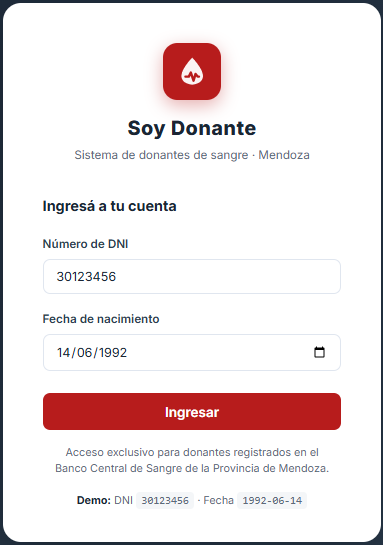

**Pasos:**

1. Escribí tu **Número de DNI**, sin puntos ni espacios (por ejemplo: `30123456`).
2. Elegí tu **Fecha de nacimiento** con el calendario o escribila en formato `dd/mm/aaaa`.
3. Presioná **Ingresar**.

### Usuarios de prueba

Para probar la aplicación podés usar cualquiera de estos usuarios de demostración:

| DNI        | Fecha de nacimiento | Usuario                        |
| ---------- | ------------------- | ------------------------------ |
| `30123456` | `14/06/1992`        | María González (Donante O+)    |
| `25441123` | `22/03/1988`        | Carlos Pérez (Donante A+)      |
| `33871002` | `08/11/1995`        | Ana Rodríguez (Donante B−)     |
| `99999999` | `01/01/1980`        | Admin Hemoterapia              |

Para **cerrar sesión**, usá el ícono de salida que aparece junto a tu nombre, abajo en el menú lateral.

---

## 2. Cómo está organizada la aplicación

Una vez dentro, la pantalla tiene tres zonas:

- **Menú lateral (izquierda):** para moverte entre las secciones. La opción en la que estás se marca en rojo. Abajo se muestra tu nombre, tu grupo sanguíneo y el botón para salir.
- **Barra superior:** muestra el título de la pantalla actual, la **campana** de notificaciones (el punto rojo indica que tenés novedades sin leer) y el ícono de configuración.
- **Contenido (centro):** la información de la sección elegida.

El menú tiene dos bloques:

| Bloque             | Opciones                                                                 |
| ------------------ | ------------------------------------------------------------------------ |
| **Principal**      | Panel de control · Mi perfil · Historial · Tarjeta digital               |
| **Administración** | Donantes · Centros de donación · Notificaciones · Stock de sangre · Reportes |

---

## 3. Sección Principal

### Panel de control

Es la pantalla de inicio. Te da un resumen de todo de un vistazo.

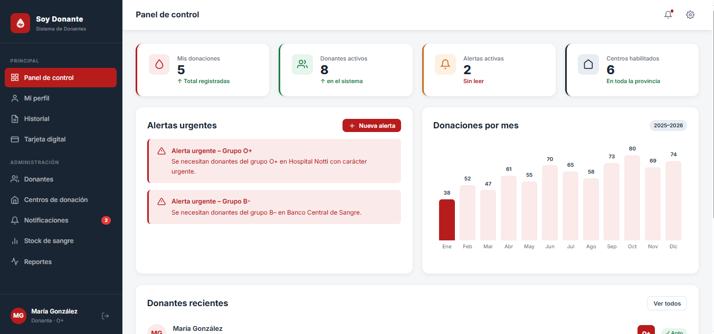

- **Indicadores superiores:** *Mis donaciones* (total registradas), *Donantes activos* en el sistema, *Alertas activas* sin leer y *Centros habilitados* en la provincia.
- **Alertas urgentes:** avisos de grupos sanguíneos que se necesitan con urgencia y en qué centro. El botón **+ Nueva alerta** permite crear una.
- **Donaciones por mes:** gráfico de barras con las donaciones de cada mes del período 2025–2026.
- **Donantes recientes:** lista con nombre, DNI, cantidad de donaciones, grupo sanguíneo y estado (*Apto* / *No disponible*). El botón **Ver todos** abre el listado completo.

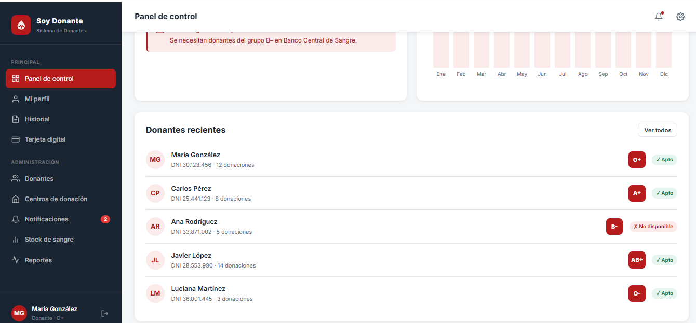

### Mi perfil

Reúne tus datos como donante.

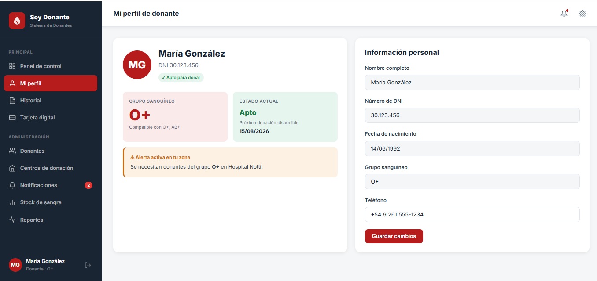

- **Grupo sanguíneo** y con qué grupos sos compatible.
- **Estado actual:** si estás *Apto* para donar y la fecha de tu **próxima donación disponible**.
- **Alerta activa en tu zona:** si tu grupo sanguíneo se necesita con urgencia, aparece acá.
- **Información personal:** nombre, DNI, fecha de nacimiento y grupo sanguíneo (estos datos aparecen bloqueados) y tu **teléfono**, que podés modificar. Para guardar el cambio, presioná **Guardar cambios**.

### Historial

Muestra todas tus donaciones anteriores.

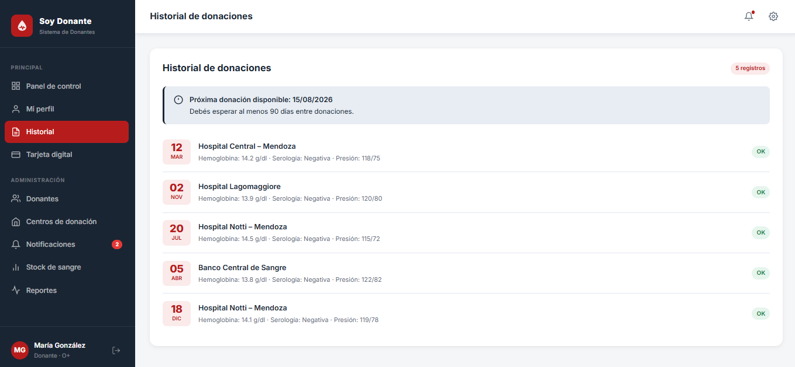

- Arriba se indica tu **próxima donación disponible** y el recordatorio de que debés esperar **al menos 90 días entre donaciones**.
- Cada registro muestra la **fecha**, el **centro** donde donaste y los resultados del control: **hemoglobina**, **serología** y **presión arterial**, con su estado (*OK*).

### Tarjeta digital

Es tu credencial de donante, con tu grupo sanguíneo y un código QR de verificación.

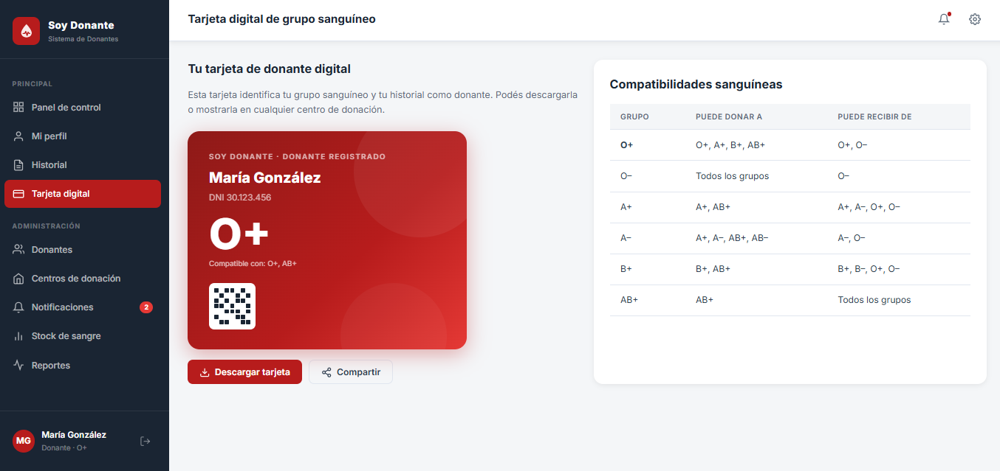

- **Descargar tarjeta:** guarda la tarjeta en tu dispositivo.
- **Compartir:** te permite enviarla.
- Podés mostrarla en cualquier centro de donación para identificarte.
- A la derecha encontrás la tabla de **Compatibilidades sanguíneas**, que indica a qué grupos puede donar y de cuáles puede recibir cada grupo sanguíneo.

| Grupo | Puede donar a       | Puede recibir de    |
| ----- | ------------------- | ------------------- |
| O+    | O+, A+, B+, AB+     | O+, O−              |
| O−    | Todos los grupos    | O−                  |
| A+    | A+, AB+             | A+, A−, O+, O−      |
| A−    | A+, A−, AB+, AB−    | A−, O−              |
| B+    | B+, AB+             | B+, B−, O+, O−      |
| AB+   | AB+                 | Todos los grupos    |

---

## 4. Sección Administración

Herramientas de gestión pensadas para el equipo del Servicio de Hemoterapia.

### Donantes

Listado de todos los donantes registrados.

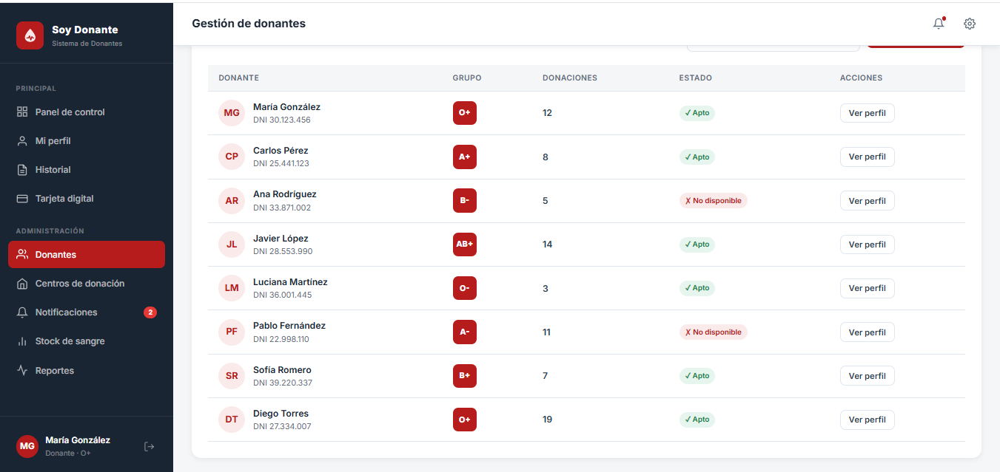

Para cada donante se ve su nombre y DNI, su **grupo sanguíneo**, la cantidad de **donaciones**, su **estado** (*Apto* o *No disponible*) y el botón **Ver perfil** para consultar sus datos.

### Centros de donación

Lista de los centros habilitados, con dirección y horario de atención.

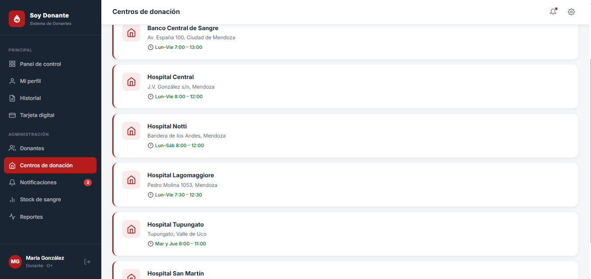

| Centro                  | Dirección                   | Horario                |
| ----------------------- | --------------------------- | ---------------------- |
| Banco Central de Sangre | Av. España 100, Ciudad de Mendoza | Lun–Vie 7:00 – 13:00 |
| Hospital Central        | J.V. González s/n, Mendoza  | Lun–Vie 8:00 – 12:00   |
| Hospital Notti          | Bandera de los Andes, Mendoza | Lun–Sáb 8:00 – 12:00 |
| Hospital Lagomaggiore   | Pedro Molina 1053, Mendoza  | Lun–Vie 7:30 – 12:30   |
| Hospital Tupungato      | Tupungato, Valle de Uco     | Mar y Jue 8:00 – 11:00 |
| Hospital San Martín     | Consultá el detalle en la app |                      |

### Notificaciones

Todas las novedades en un solo lugar, ordenadas de la más reciente a la más antigua. Un **punto rojo** marca las que todavía no leíste, y el número rojo en el menú indica cuántas hay pendientes.

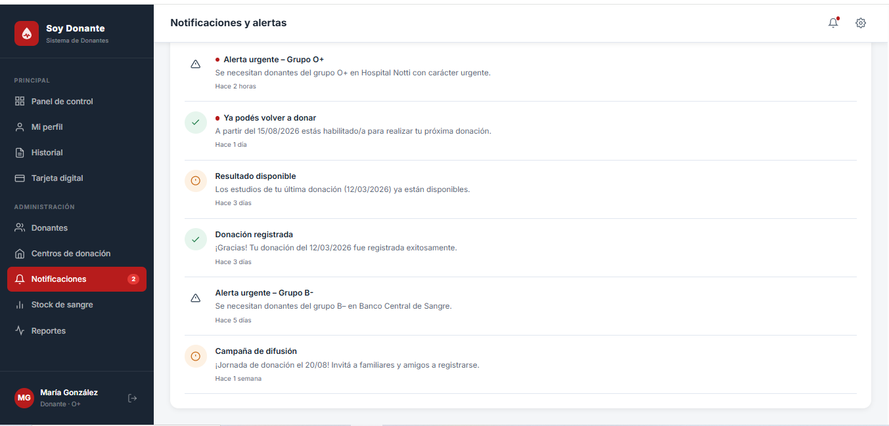

Tipos de aviso:

- **Alerta urgente:** se necesitan donantes de un grupo sanguíneo en un centro determinado.
- **Ya podés volver a donar:** se cumplió el tiempo de espera y estás habilitado/a para donar.
- **Resultado disponible:** ya están listos los estudios de tu última donación.
- **Donación registrada:** confirmación de que tu donación fue cargada en el sistema.
- **Campaña de difusión:** jornadas de donación y convocatorias.

### Stock de sangre

Muestra cuántas unidades hay disponibles de cada grupo sanguíneo.

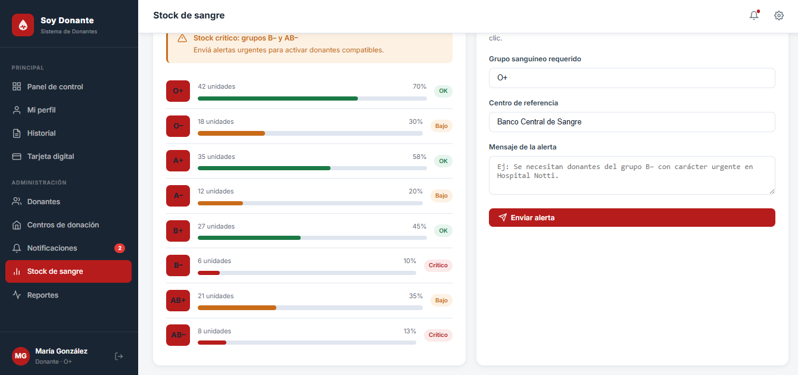

- Cada grupo tiene una **barra de nivel** con la cantidad de unidades y el porcentaje, y una etiqueta de estado: **OK**, **Bajo** o **Crítico**.
- Si hay grupos en situación crítica, se muestra un aviso de **Stock crítico** en la parte superior.
- Con el formulario de la derecha podés **enviar una alerta**: elegí el *grupo sanguíneo requerido*, el *centro de referencia*, escribí el *mensaje de la alerta* y presioná **Enviar alerta**. La alerta les llega a los donantes compatibles.

### Reportes

Métricas para seguir el impacto de la aplicación.

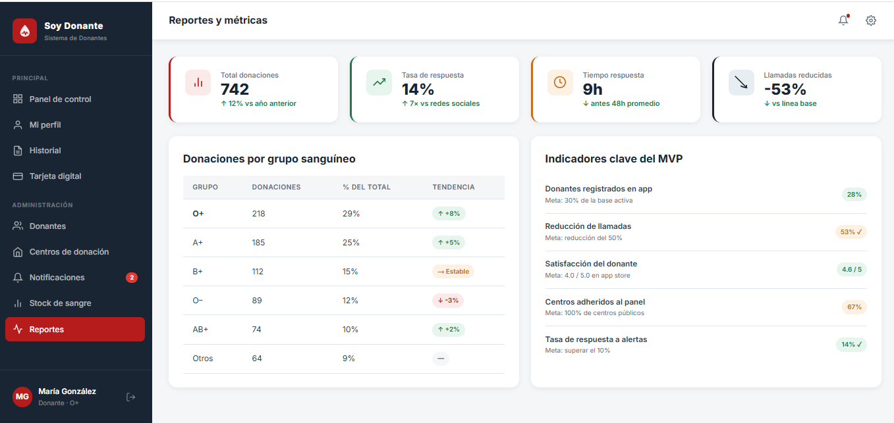

- **Indicadores generales:** total de donaciones, tasa de respuesta a las alertas, tiempo de respuesta y reducción de llamadas.
- **Donaciones por grupo sanguíneo:** cantidad, porcentaje del total y tendencia de cada grupo.
- **Indicadores clave del MVP:** avance de cada indicador frente a su meta (donantes registrados en la app, reducción de llamadas, satisfacción del donante, centros adheridos y tasa de respuesta a alertas).

---

## 5. Preguntas frecuentes

**¿Cada cuánto puedo donar sangre?**
Tenés que esperar al menos **90 días** entre una donación y la siguiente. En *Mi perfil* y en *Historial* ves la fecha de tu próxima donación disponible.

**¿Cómo sé si estoy apto/a para donar?**
En *Mi perfil*, dentro de **Estado actual**, figura si estás *Apto* o *No disponible*.

**¿Dónde veo los resultados de mis estudios?**
En *Historial* (hemoglobina, serología y presión de cada donación). Cuando estén listos, además te llega una notificación de *Resultado disponible*.

**¿Cómo demuestro que soy donante?**
Con tu **Tarjeta digital**: podés descargarla, compartirla o mostrarla en cualquier centro de donación.

**¿Cómo me entero si mi grupo sanguíneo se necesita con urgencia?**
Por las **alertas urgentes**: aparecen en el Panel de control, en tu perfil (*Alerta activa en tu zona*) y en *Notificaciones*.

**¿Dónde puedo ir a donar?**
En la sección *Centros de donación* están las direcciones y los horarios de cada centro habilitado.

**No puedo ingresar, ¿qué hago?**
Revisá que el DNI esté escrito **sin puntos** y que la fecha de nacimiento sea la correcta. Recordá que solo pueden acceder los donantes registrados en el Banco Central de Sangre de Mendoza.

---

## 6. Sobre el proyecto

| | |
| --- | --- |
| **Universidad** | UTN – Facultad Regional San Rafael |
| **Carrera** | Tecnicatura Universitaria en Programación |
| **Cátedra** | Metodología de Sistemas I |
| **Docente / Tutor** | Osvaldo Giordanini |
| **Organismo destinatario** | Servicio de Hemoterapia – Ministerio de Salud, Provincia de Mendoza |
| **Año** | 2026 |

### Equipo — Escuadrón Lobo

Lucas Nicolás Aguilar · Valentín Bertolone · Andrea Cecilia Farias · Juan Moreno · Valeria Pinaya · Darío Scilipoti · Orlando Zelada
